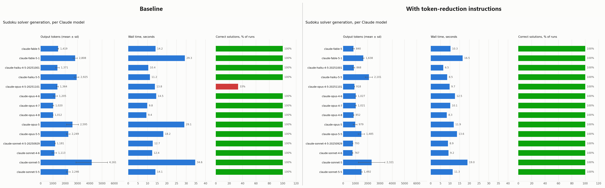

# Token Experiment

How many output tokens do Claude models spend writing the same small program, and how much does a block of "be concise" instructions in the prompt change that?

Every Claude model available through the API was asked to write a Sudoku solver in Python. Each model ran 3 times with two prompts:

- **Baseline**: [`task.md`](SudokuSolver/task.md), the spec only.
- **With token-reduction instructions**: [`task_withTokenReductionInstructions.md`](SudokuSolver/task_withTokenReductionInstructions.md), the same spec plus 12 rules asking for minimal output (no comments, docstrings, explanations, unnecessary abstractions, etc.).

Every generated solver was run against the test puzzle in the prompt and marked correct only if its output matched the expected solution exactly.

## Results



Totals across 14 models × 3 runs (42 generations per prompt):

| | Baseline | With instructions | Change |
|---|---:|---:|---:|
| Output tokens | 80,001 | 51,305 | −36% |
| Wall time | 700.6 s | 469.5 s | −33% |
| Correct solutions | 40 / 42 | 42 / 42 | +2 |
| Mean lines of code | 153.9 | 77.4 | −50% |
| Input tokens per request | 383–494 | 589–814 | about +200 to +320 |

Per model, mean output tokens:

| Model | Baseline | With instructions | Change |
|---|---:|---:|---:|
| claude-fable-5 | 1,419 | 840 | −41% |
| claude-fable-5-1 | 2,808 | 1,638 | −42% |
| claude-haiku-4-5-20251001 | 1,371 | 868 | −37% |
| claude-haiku-5-5 | 2,925 | 2,101 | −28% |
| claude-opus-4-5-20251101 | 1,364 | 918 | −33% |
| claude-opus-4-6 | 1,205 | 1,027 | −15% |
| claude-opus-4-7 | 1,020 | 1,021 | 0% |
| claude-opus-4-8 | 1,012 | 852 | −16% |
| claude-opus-5 | 2,595 | 979 | −62% |
| claude-opus-5-5 | 2,249 | 1,485 | −34% |
| claude-sonnet-4-5-20250929 | 1,181 | 793 | −33% |
| claude-sonnet-4-6 | 1,113 | 767 | −31% |
| claude-sonnet-5 | 4,161 | 2,321 | −44% |
| claude-sonnet-5-5 | 2,246 | 1,492 | −34% |

### Observations

- The instructions cut output tokens for 13 of 14 models; only claude-opus-4-7 was unchanged, and it was already one of the most concise.
- The models that wrote the most in the baseline (claude-sonnet-5, claude-opus-5, claude-fable-5-1) saved the most.
- Correctness didn't suffer. claude-opus-4-5-20251101 failed 2 of 3 baseline runs and passed all 3 with the instructions.
- The rules add a few hundred input tokens per request. Output tokens cost more than input tokens, so for this task the trade is clearly worth it.
- claude-sonnet-5 varies a lot from run to run in both conditions (sd above 1,000 tokens).

### Caveats

- 3 runs per model per prompt is a small sample; treat per-model differences of a few hundred tokens as noise.
- One task, one language. A Sudoku solver is short and well specified; results may differ for larger or vaguer tasks.
- Wall time depends on API load at the time of the run, so it is only a rough signal.

## Repository layout

```
SudokuSolver/
  task.md                                    baseline prompt
  task_withTokenReductionInstructions.md     prompt with the 12 token-reduction rules
  measure_models.py                          runs the prompt against every model, checks the code, writes CSV
  plot_results.py                            turns a CSV into a chart
  results.csv                                baseline, one row per run
  results_withTokenReductionInstructions.csv with instructions, one row per run
  generated/                                 every solver written for the baseline prompt
  generated_withTokenReductionInstructions/  every solver written for the instructions prompt
  *_sharedAxes.png                           charts drawn on the same axes so they compare directly
```

## Reproducing

Requires Python 3.9+ and an Anthropic API key.

```bash
cd SudokuSolver
pip install anthropic matplotlib
export ANTHROPIC_API_KEY=...

# Run the experiment (writes results.csv and generated/)
python measure_models.py --runs 3 --task task.md
```

`measure_models.py` always writes to `results.csv` and `generated/`. To run the second prompt, move those out of the way first, then rename the new output:

```bash
python measure_models.py --runs 3 --task task_withTokenReductionInstructions.md
```

Use `--only sonnet,haiku` to limit the run to model IDs containing those substrings.

Draw the charts with shared axes so the two conditions compare directly:

```bash
python plot_results.py results.csv --out results_sharedAxes.png \
  --share-axes-with results_withTokenReductionInstructions.csv
python plot_results.py results_withTokenReductionInstructions.csv \
  --out results_withTokenReductionInstructions_sharedAxes.png \
  --share-axes-with results.csv
```

`plot_results.py` also prints a per-model summary table to the terminal.
